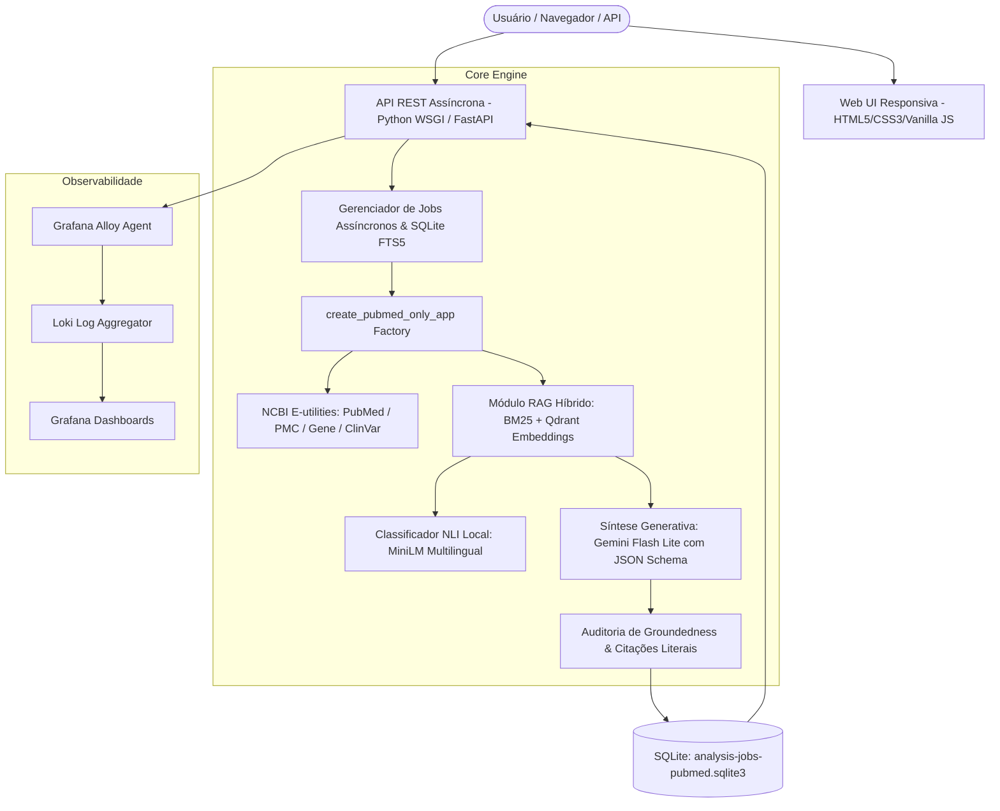

# Descrição Final do Produto ArtFact — Versão 2.0
**Produto:** ArtFact — Sistema RAG de Verificação e Análise de Evidências Biomédicas  
**Programa:** RES IA ELD UnB — Turma 1 | Grupo 08  
**Data de Lançamento:** Outubro de 2026  
**Autores:** Victor Barbosa da Silva, Keila Alves Ferreira, Thayná Gonçalves Dutra, João Vitor Carvalho Barbosa, Vinícius César Sena Torres, Ketlyn Karen Silva de Morais  
**Repositório Oficial:** `https://github.com/joaocarvv/r.ia-FakeNews`  
**Branch de Referência:** `refactor/pubmed-only-mvp`

---

## 1. Visão Geral do Produto

O **ArtFact** é uma plataforma baseada em Inteligência Artificial que capacita pesquisadores, profissionais de saúde, comunicadores científicos e cidadãos a investigar, analisar e confrontar alegações sobre saúde diretamente contra a literatura científica primária indexada.

Operando sob a arquitetura de **Geração Aumentada por Recuperação (RAG)** focada exclusivamente no ecossistema da **National Library of Medicine (PubMed e PubMed Central - PMC)**, o ArtFact v2.0 transforma a checagem de fatos tradicional em um processo **transparente, explicável e academicamente auditável**.

### A Filosofia Central da Versão 2.0
> **A aplicação não carimba se um artigo é "verdadeiro" ou "falso".**  
> Em saúde, conclusões científicas dependem do desenho do estudo, do tamanho amostral, da população analisada e da replicabilidade dos achados. O ArtFact organiza trechos citáveis, classifica relações textuais formais (*Apoio*, *Contradição*, *Neutro* ou *Incerto*), exibe a cobertura real do material consultado e preserva a autonomia e o senso crítico do usuário.

---

## 2. Proposta de Valor e Diferenciais

| Funcionalidade Tradicional de Checagem | Abordagem do ArtFact v2.0 |
|---|---|
| **Veredito Categórico:** Resposta binária ("Verdadeiro" / "Falso") gerada por IA opaca. | **Matriz de Relações e PICO:** Exposição detalhada de evidências contrárias, favoráveis e inconclusivas, sem carimbos arbitrários. |
| **Alucinações e Citações Fictícias:** Modelos LLM inventam links e referências plausíveis. | **Groundedness Estrutural:** Exigência de citações literais idênticas ao texto original e validação estrita de IDs de passagens (`passage_id`). |
| **Dispersão em Múltiplas Bases Não Confiáveis:** Falhas de rede em repositórios abertos fragmentados. | **Núcleo de Confiança NLM:** Coleta centralizada no PubMed, texto completo garantido via PMC e consultas genômicas ao NCBI Gene/ClinVar. |
| **Uma Pergunta por Vez:** Chatbot com sessões voláteis e esquecimento de contexto. | **Múltiplas Alegações e Biblioteca Local:** Extração de múltiplas alegações por artigo, navegação em abas e persistência em SQLite com busca FTS5. |
| **Opacidade de Fontes Retratadas:** Estudos com fraudes ou erros metodológicos tratados como válidos. | **Filtro de Retratações:** Exclusão automática de artigos retratados da síntese de evidências e alerta visual destacado na interface. |

---

## 3. Principais Módulos e Funcionalidades

### 3.1 Três Modos de Entrada e Investigação
1. **Busca por Tema (`POST /api/v1/pubmed-search`):**
   - Aceita termos de saúde em português ou inglês;
   - Desdobra a dúvida em consultas biomédicas com MeSH Terms via Gemini, exibindo de forma transparente ao usuário os termos formulados;
   - Filtros dinâmicos opcionais: todas as publicações (`ALL`), apenas revisões sistemáticas/meta-análises (`REVIEWS`) ou apenas ensaios clínicos randomizados (`TRIALS`);
   - Apresenta até 10 estudos relacionados para seleção antes do disparo da análise.
2. **Verificação de Artigo Específico:**
   - Ingestão direta via PMID (ex.: `31234567`), DOI indexado, link canônico do PubMed ou upload manual de arquivos (PDFs científicos ou imagens);
   - Leitura automatizada do texto integral via PMC; quando indisponível, realiza fallback transparente informando que a análise repousa sobre o abstract do PubMed.
3. **Comparação Manual Dirigida (`src/fatofake/manual_comparison.py`):**
   - Permite que o usuário selecione até **20 referências específicas** (da sua biblioteca local, PMIDs, links ou arquivos);
   - O sistema restringe o confronto exclusivamente a esse conjunto documental, bloqueando comparações tautológicas (o artigo contra si mesmo).

### 3.2 Suporte a Múltiplas Alegações por Artigo (`notebooks/27`)
- Um único artigo científico frequentemente aborda múltiplos desfechos clínicos (ex.: sobrevida global, efeitos colaterais e biomarcadores).
- O ArtFact lê o documento e extrai atomicamente as alegações identificadas.
- O usuário seleciona quais alegações deseja auditar em lote; o sistema processa cada alegação de forma independente, sem necessidade de reler o arquivo ou reprocessar o corpus.
- Possibilidade de adicionar alegações personalizadas em texto livre, identificadas na interface como "conteúdo do usuário".

### 3.3 Leitor Científico Interativo e Rastreabilidade Visual
- **Interface Organizada em Abas:**
  - Aba 1: **Fonte** (metadados oficiais, revista, ano, autores, DOI e tipo de publicação NLM);
  - Aba 2: **Leitor** (texto completo ou abstract com marcação colorida dos trechos que fundamentam cada alegação investigada);
  - Aba 3: **Evidências** (síntese analítica, balanço de trechos e tabela estruturada).
- Ao passar o cursor ou tocar no trecho realçado, o usuário visualiza instantaneamente a alegação correspondente e o grau de aderência textual.

### 3.4 Pesquisa Biomédica Dinâmica (NCBI Gene e ClinVar)
- Durante a verificação, alegações que mencionam variantes genéticas (ex.: mutações *BRCA1*, variantes em oncogenes) acionam automaticamente consultas paralelas aos bancos oficiais de dados genômicos do NCBI.
- O resultado é exibido em um card dedicado (*Pesquisa Biomédica Dinâmica*), sem misturar registros genômicos estruturados com literatura de ensaios clínicos.

### 3.5 Biblioteca Local Persistente em SQLite (`src/fatofake/library.py`)
- Banco de dados local padrão: `data/analysis-jobs-pubmed.sqlite3`;
- Motor de indexação textual **SQLite FTS5** (*Full-Text Search 5*);
- Permite salvar artigos, registrar notas técnicas pessoais, adicionar etiquetas customizadas e revisitar análises prévias instantaneamente, mesmo em modo offline.

---

## 4. Arquitetura Técnica e Stack Tecnológico

### Componentes de Software:
- **Linguagem Principal:** Python 3.11 gerenciado via `uv`.
- **Backend e API:** Arquitetura desacoplada assíncrona com suporte a rotas HTTP RESTful e entrega estática de interface web.
- **Armazenamento e Indexação:** SQLite com extensão FTS5 nativa para texto integral e biblioteca local.
- **Camada Vetorial:** Qdrant / mecanismo em memória com embeddings densos (`sentence-transformers/paraphrase-multilingual-MiniLM-L12-v2`).
- **Recuperação Léxica:** Algoritmo BM25 otimizado com normalização morfológica.
- **Fusão de Ranks:** Reciprocal Rank Fusion (RRF) determinístico com constante $k=60$.
- **Classificação de Incerteza e NLI:** `MoritzLaurer/multilingual-MiniLMv2-L6-mnli-xnli` com limiares de segurança para abstenção.
- **Síntese Generativa:** Google Gemini (`gemini-flash-lite-latest`) com validação de esquema estrito.
- **Observabilidade:** Grafana Alloy + Loki + Grafana para monitoramento estruturado de requisições, tokens e taxa de erro.
- **Conteinerização:** `Dockerfile` multi-stage e `docker-compose.yml` para implantação em qualquer sistema operacional.

---

## 5. Salvaguardas Éticas e Limitações Declaradas

1. **Ausência de Interpretação Médica Subjetiva:** A localização literal de uma citação em um artigo comprova unicamente que o autor fez aquela afirmação, não garantindo que o desenho metodológico esteja isento de vieses. O ArtFact expõe os dados brutos e trechos textuais, sem substituir pareceres de profissionais habilitados.
2. **Tratamento de `PublicationType`:** Os tipos de publicação exibidos são aqueles catalogados pela base PubMed (ex.: *Journal Article*, *Clinical Trial*, *Review*), sem afirmação de confirmação independente de qualidade pela IA.
3. **Supressão de Classificações Metodológicas Não Auditáveis:** A Versão 2.0 deliberadamente desativa pontuações automáticas de GRADE, RoB 2, ROBINS-I ou AMSTAR 2 que não possam ser comprovadas matematicamente trecho a trecho.
4. **Proteção à Privacidade e Chaves de API:** As variáveis sensíveis (`GEMINI_API_KEY`, dados do NCBI) operam isoladas via arquivos de ambiente (`.env`), nunca sendo registradas no controle de versão nem expostas no frontend.
5. **Mitigação contra Revistas Predatórias e Paper Mills:** Para combater a proliferação de fábricas de artigos científicos falsificados (*paper mills*) e periódicos predatórios desprovidos de revisão por pares idônea, o ArtFact v2.0 restringe sua busca autônoma ao ecossistema curado da NLM (PubMed/PMC), filtra e exclui compulsoriamente estudos retratados da síntese de evidências e alerta o usuário sobre potenciais comprometimentos de integridade acadêmica.

---

## 6. Conclusão e Roadmap Futuro

A **Versão 2.0 do ArtFact** cumpre integralmente os requisitos de entrega final do programa RES IA ELD UnB, consolidando uma plataforma elegante, matematicamente validada e defensável perante a comunidade acadêmica.

### Próximos Passos (Roadmap v3.0):
- Suporte a multi-usuários com autenticação e sincronização de bibliotecas pessoais em nuvem;
- Reativação progressiva e auditada das bases SciELO e OpenAlex com os mesmos padrões de groundedness da v2.0;
- Treinamento supervisionado com anotação clínica (*fine-tuning*) e avaliação contínua sobre *ground truth* expandido.
